# TasteRoom

**Plan an event from what everyone actually likes.**

TasteRoom is an AI agent for anyone planning an event for a group: a community (Discord servers, meetups, run clubs, brand communities), a team retreat or offsite, friends hanging out, or a family event.

> **Share a link, everyone adds their tastes, the agent builds a plan you can refine.**

1. **Collect.** Share one link in WhatsApp, Discord or the family chat. Everyone adds what they like on their phones in about 30 seconds
   (guided prompts, live [Qloo](https://qloo.com) autocomplete, no sign-up). Or type everyone in yourself.
2. **Plan.** An AI agent resolves those tastes to Qloo entities, builds one group taste profile, queries Qloo for
   **music, venues, brands and content**, and writes an **event brief** where every pick comes from Qloo and is explained.
3. **Refine.** Tell the agent what to change ("cheaper venue", "more hidden gems"). It re-queries only what that affects and
   updates the plan in place (with one "Undo last change"). The venues are labelled **Top pick** and **Cheapest option** (from Qloo's price levels). Every member also gets a **personal pick** found from their own tastes, and a **Coverage** card shows who has a pick made for them.
4. **Act.** Share a read-only link, copy a venue poll for your members, or post the announcement to Discord or Slack.

A **Compare** tab shows the same request answered by a plain LLM, so you can see what Qloo adds.

**Live demo:** https://tasteroom-production-d52a.up.railway.app &nbsp;·&nbsp; **License:** MIT &nbsp;·&nbsp; Built for the Qloo Agentic Hackathon

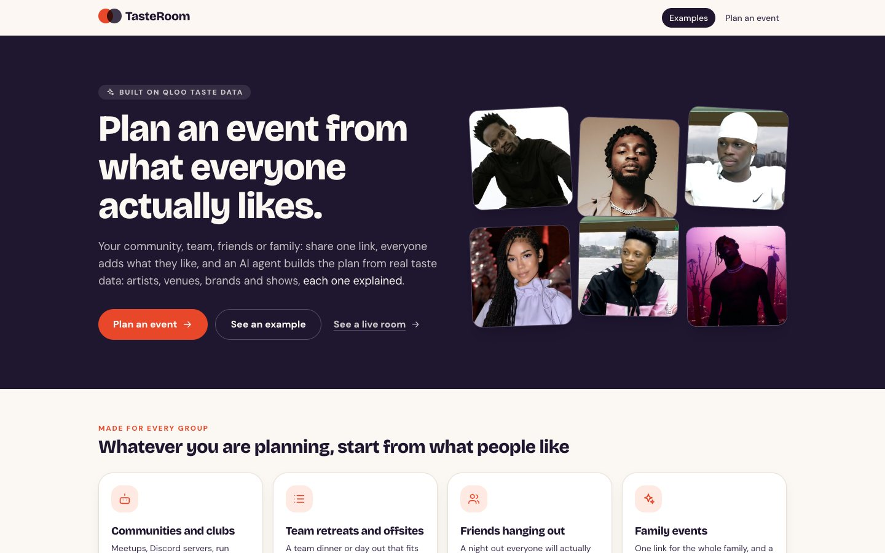

### Try it in 60 seconds

1. Open the live demo and click the **Lagos Creators** example (the brief opens instantly).
2. **Compare** tab: the same request answered by a plain LLM, measured against the Qloo-grounded plan.
3. Back on **Brief**, see **Something for everyone** (one personal pick per member, one line each, with the numbers behind **Why?**). Open **How are these picked?** for the rules.
4. In the **Brief**, find the venue section: the **Top pick** and the **Cheapest option** (Qloo's lowest price level among that city's venue results), each with its price. Then in the **Refine** box tap **More hidden gems**: it takes 20 to 40 seconds, updates your own copy of the example in place, and **Undo last change** puts it back.
5. Landing page: **See a live room**, the demo invite room with 8 member responses.

## Why this needs Qloo

> If the app would work the same without Qloo, it is the wrong app.

- **Every recommendation shown is a Qloo result.** The LLM organizes and writes; it never supplies picks. A validator
  removes any pick in the brief that Qloo did not return for that section (and restores Qloo's canonical name).
  The number removed is returned with every plan (`dropped_picks`).
- **Explanations are Qloo's own.** "Why this pick" uses Qloo's `feature.explainability` scores mapped back to the members
  who named each input entity. Nothing is invented.
- **The Compare tab measures the difference** instead of claiming it (see [What Compare shows](#what-compare-shows)).

| Brief | Why this pick |
|---|---|
| 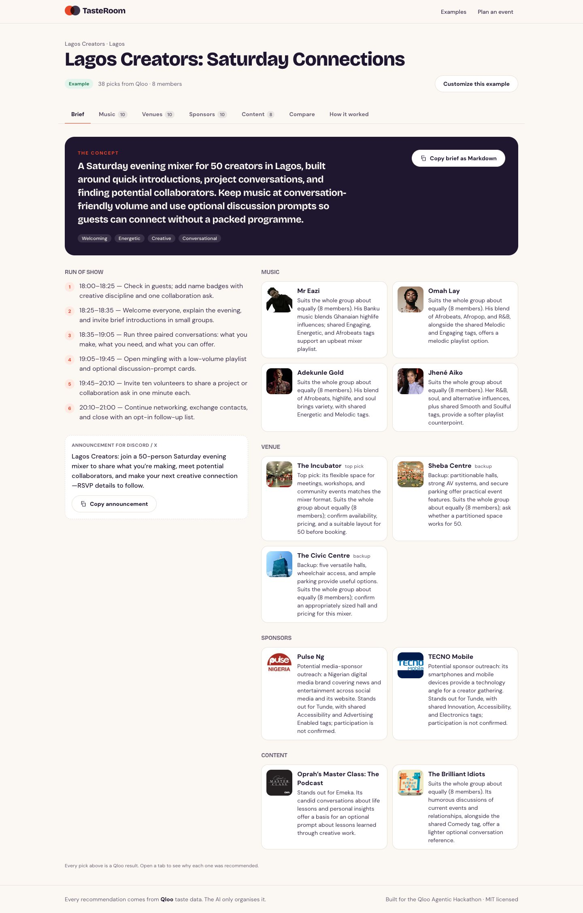 | 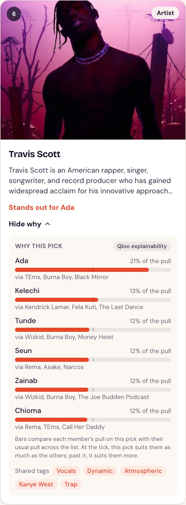 |

## The host workflow

| 1. Guided input with live Qloo autocomplete | 2. Members join from their phones |
|---|---|
| 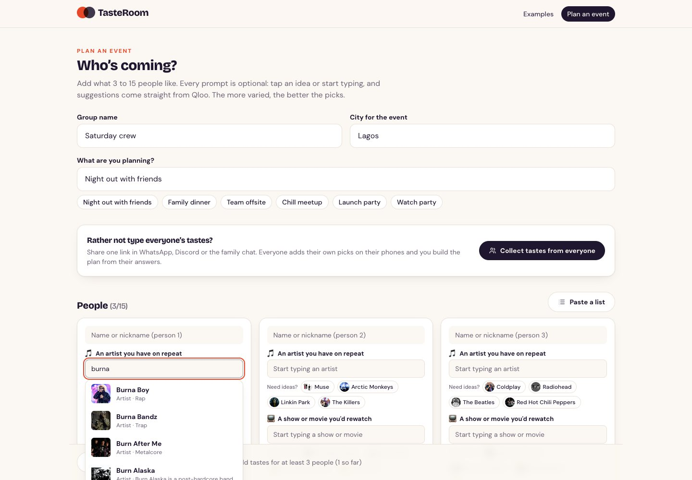 | 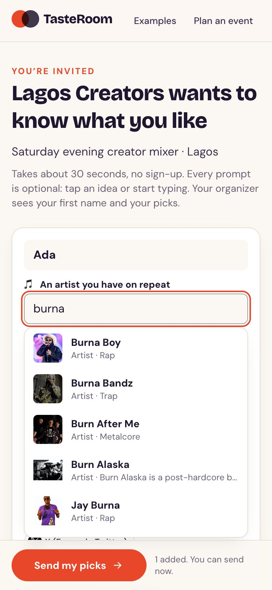 |
| Five optional prompts per member (an artist on repeat, a show to rewatch, a brand, a podcast, a spot). Suggestions come from Qloo as you type; picking one pins the exact entity. "Need ideas?" chips are popular picks from Qloo. | **Collect tastes from members** creates an invite room: a join link, a copy-ready Discord/WhatsApp message and a QR code. The organizer page updates as members respond and builds the plan from up to 15 of them. No login; only first names and picks are stored. |

| 3. Refine with the agent | 4. Something for everyone |
|---|---|
| 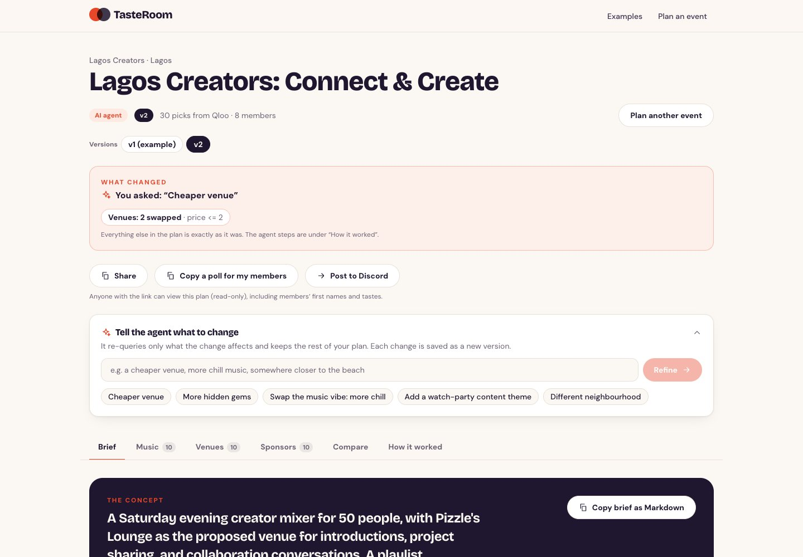 | 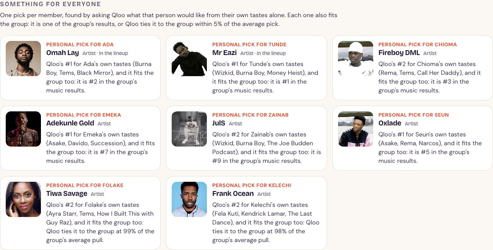 |
| A refinement re-runs **only** the domains it affects (the trace shows exactly which tool calls ran); every other section is kept verbatim. The change updates the plan in place, with a "What changed" strip and an **Undo last change** link (one level). On a shared example you get your own copy, so the example never changes. | One pick per member, found by asking Qloo what *that person* would like from their own tastes alone (one `/v2/insights` query per member, seeded only by them). Each also fits the group; the card says which of their tastes it came from, and **Why?** shows the rank and how it fits. |

**Coverage counts two different things and never blends them** (the Compare tab shows both numbers; the Brief tab shows each member's card instead): A pick *stands out* for a member when their pull on it is at least 15% above their
usual level (the strict bar, unchanged). A *personal pick* is made for the member by construction. On the three community examples, **2 of 8, 0 of 7 and 0 of 7**
members have a pick that stands out in the lineup (Qloo's explainability scores are close to uniform, so most picks are crowd-pleasers), while
**8 of 8, 7 of 7 and 7 of 7** have a personal pick, so every member has a card in "Something for everyone" (a member without one would be listed there with the reason), and the split sits in the Compare tab. Be aware that 16 of the 27 personal picks are also results the group query returned, so a personal pick is often a crowd-pleaser too; the
card says so ("it is #2 in the group's music results"). The rule for "fits the group" (within 5% of the group's average affinity) is a round number,
not a tuned one: at 3% or 10% every member of every example still gets a pick (`API_FINDINGS.md`). Two Pixel Pact members, Jonas and Tessa, have no music
pick that fits the group, so their personal picks are shows (Made in Abyss, Shadow and Bone); a member with none in a domain is listed with the reason,
never hidden.

A lineup has only 3 to 4 slots per section, which is why the "Something for everyone" row exists: it gives every member a pick made from their own tastes without crowding out the group's picks.

A personal pick that sits in the main lineup says so: its row starts "Personal pick for <name>: Qloo's top match for their tastes (…), and it fits the group too", followed by the group data only when it is true ("It also stands out for Tessa", or "It is a crowd-pleaser: it fits all 7 members"), and carries a "Personal pick · <name>" badge in the brief and on the Music and Content cards. This is written from Qloo's data after the brief is generated (`backend/app/attribution.py`), so the model's prose can't replace the member's name.

**Share and act.** *Share* copies a read-only link (`/plan/<id>?shared=1`, badge "Shared plan", no editing controls; anyone with the link
can view the plan, including members' first names and tastes). *Copy a poll for my members* gives ready-to-paste text for the top 3 venues.
*Post to…* opens a small menu with **Discord** and **Slack**; pick one, paste that service's webhook URL, and the app shows exactly what will be posted
and needs a confirm click. The pasted URL is used once: it is never stored or logged, the server posts only to a `discord.com` or `hooks.slack.com` address
it builds itself, and the message cannot ping anyone (Slack text is escaped, Discord's mentions are switched off). Use the same button to switch service.

## How it works

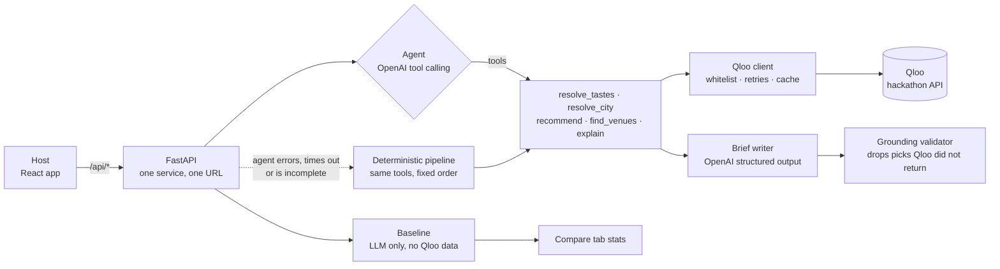

1. **Resolve** each member's tastes to Qloo entities (typed search, then an untyped retry; best by name similarity,
   then popularity; weak matches are rejected). The city is resolved to a Qloo *locality* and validated against the
   locality's name and aliases, so a nonsense city cannot silently become a different place.
2. **Profile**: entities named by several members weigh more; for large groups the 25-entity signal is filled
   round-robin so no member is crowded out.
3. **Agent** (OpenAI Responses API, tool calling) reads the event goal and decides which domains this event needs.
   Filters (venue type, day, price, hidden gems) apply only if you set them or your goal implies them ("Saturday",
   "on a budget"); goal-implied ones are labelled *inferred from your goal* in the trace, and anything else the agent asks for is dropped.
   A launch party gets music, venues and sponsors; a podcast-listening meetup gets content and venues.
   Every tool call is recorded and shown in the **How it worked** tab.
4. **Recommend**: one Qloo `/v2/insights` query per domain, each with its own signal (see
   [Findings that shaped the design](#findings-that-shaped-the-design)).
5. **Explain** each pick from Qloo's explainability data.
6. **Brief**: a stronger model writes the brief from a compact list of Qloo results; the validator enforces grounding.

If the agent errors, times out (60 s budget, max 10 tool calls) or finishes incompletely, the **deterministic pipeline**
runs the same tools in a fixed order and keeps whatever the agent already gathered. The demo cannot fail because of the
agent. If the brief writer fails, a templated brief is built from the same Qloo data. With no API keys at all, the app
runs end to end in **mock mode** on saved samples.

## How Qloo is used

| Qloo endpoint | Used for | Key parameters |
|---|---|---|
| `GET /search` | Resolve each taste to an entity; resolve the city to a locality | `query`, `types` (artist, brand, podcast, tv_show, movie, book, videogame, place, **locality**), `take` |
| `GET /v2/insights` | The recommendations: artists, venues, brands, podcasts + TV shows | `filter.type`, `signal.interests.entities`, **`feature.explainability`**, `filter.location` (locality ID), `filter.popularity.max` (hidden gems), `filter.price_level.max`, `filter.hours`, `filter.tags`, `take` |
| `GET /v2/tags` | Turn a venue kind ("lounge", "event venue") into a valid place tag ID | `filter.query` |

Also implemented and verified live, but not exposed in the UI: `/v2/audiences` (audience signal via
`signal.demographics.audiences`) and per-member affinity via `filter.results.entities`. `/entities` (batch fetch, up to 50 IDs)
resolves autocomplete picks in one call. All Qloo access goes through one client (`backend/app/qloo_client.py`) with a per-type
**parameter whitelist** (`allowed_params.py`), because Qloo silently ignores unknown parameters.

### Which app routes call Qloo

| App route | What it does | Qloo calls |
|---|---|---|
| `GET /api/suggest` | Autocomplete for a guided slot (debounced, cached, rate limited) | `/search` with `types` from the slot, `take=6` |
| `GET /api/ideas` | "Need ideas?" chips: popular entities for a slot, no taste signal | `/v2/insights` with `filter.popularity.min=0.9` (places: `filter.location` + a hangout tag union) |
| `POST /api/resolve`, `POST /api/plan` | Check tastes; build a plan | `/search`, `/entities` (one batch for picked suggestions), `/v2/insights`, `/v2/tags`; then, for personal picks, one `/v2/insights` per member per domain (music, content; 4 at a time) and a `filter.results.entities` lookup of the group's affinity for candidates outside its results |
| `POST /api/plan/{id}/refine` | Re-run only the domains a request affects; updates the plan in place (a copy for a shared example); `POST /api/plan/{id}/undo` undoes the last change | `/v2/insights` (+ `/v2/tags` for moods; neighbourhood ids as `filter.location`); personal picks are redone only if music or content changed |
| `/api/rooms/*` | Invite rooms: create, join, list responses, build a plan from them | none until the plan is built (then as `/api/plan`) |
| `GET /api/plan/{id}/announcement` (`?service=slack` for Slack), `POST /api/plan/{id}/discord`, `POST /api/plan/{id}/slack` | Preview and send the announcement | none |

### Findings that shaped the design

Qloo's docs and its behavior differ in places, so everything was tested live ([`API_FINDINGS.md`](API_FINDINGS.md) has the
evidence for each point):

- **Native explainability works** (artist, brand, place), but its split across inputs is close to uniform, so raw
  per-member shares mostly show *how many tastes a member listed*. TasteRoom divides by the share that entity count alone
  would predict, then compares each member's pull on a pick with their *usual* pull across the whole list. What remains is
  pick-specific signal. Most picks honestly read "A crowd-pleaser: fits all N members"; a few genuinely stand out for someone.
- **What you feed Qloo matters.** Brands in the signal drag music, venue and content results toward global luxury
  names; artists + shows give on-taste results; sponsors match best from artists + brands. Each domain has its own signal.
- **A location filter is mandatory for venues.** Without one, a Nigerian taste profile still returns Lagos venues
  (Qloo infers location from taste). The locality-ID route works; `filter.geocode.*` returned nothing.
- **Per-entity weights are not supported** (`signal.interests.entities.weight` takes one number for the whole group), so
  weighting is done client-side.
- **Rate limits are real.** 6 parallel requests never hit a 429; 10 did, so concurrency is capped at 6 with exponential
  backoff, and a lookup that fails because Qloo is busy is reported as "busy" rather than blamed on the organizer's spelling.

## What Compare shows

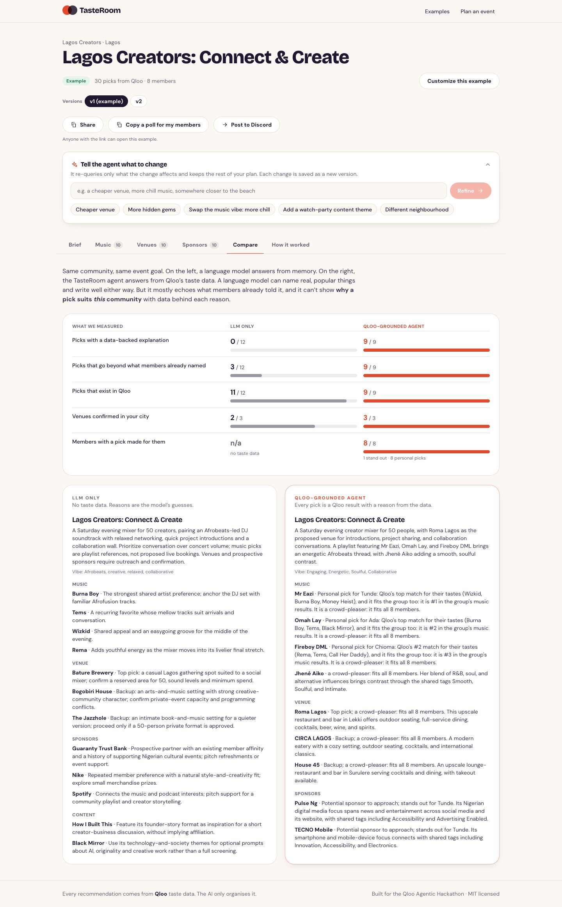

For the same group and goal, the LLM-only answer is compared with the Qloo-grounded one:

| Measured | LLM only | Qloo-grounded |
|---|---|---|
| Picks with a data-backed explanation | 0 | all |
| Picks that go beyond what members already named | ~3 of 12 (it mostly echoes the input) | all |
| Picks that exist in Qloo | ~all | all (by construction) |
| Venues confirmed in the city (by Qloo's own geocode) | 2 to 3 of 3 | 3 of 3 |
| Members with a pick made for them (coverage) | n/a: no taste data | 8 of 8 (Lagos), 7 of 7, 7 of 7 (of which 2, 0 and 0 stand out in the lineup) |

The LLM does name real, popular things. Those rows are shown anyway because an honest comparison matters more than a
dramatic one. What it cannot do is explain *why a pick suits this group* with data, or discover beyond the input.

## Screens

| How it worked: the agent's real tool calls | Mobile |
|---|---|
| 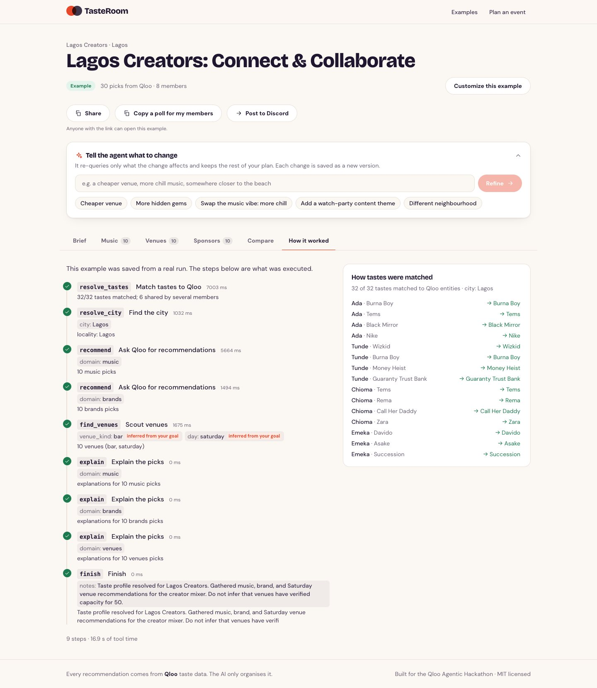 | 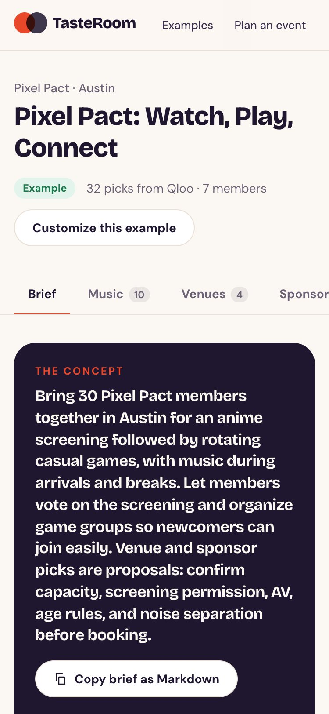 |

## Run it locally

```bash
cp .env.example .env     # add your keys; .env is git-ignored. With no keys the app runs in mock mode.
make setup
make dev-api             # terminal 1: FastAPI on :8000
make dev-web             # terminal 2: Vite on :5173 (proxies /api to :8000)
```

One-port, production style: `make serve`, then open http://localhost:8000.

| Variable | Purpose | Default |
|---|---|---|
| `QLOO_API_KEY` | Qloo hackathon key (unset = mock mode) | none |
| `OPENAI_API_KEY` | OpenAI key (unset = templated brief, no agent) | none |
| `OPENAI_MODEL_FAST` | Agent tool loop | `gpt-6-luna` |
| `OPENAI_MODEL_SMART` | Brief writer and LLM-only baseline | `gpt-6.1-sol` |
| `QLOO_BASE_URL` | Qloo host | `https://hackathon.api.qloo.com` |
| `RATE_LIMIT_PLAN` | Live plans per visitor (cached plans are free) | `5/hour` |
| `RATE_LIMIT_SUGGEST` | Autocomplete + idea lookups per visitor | `60/minute` |
| `RATE_LIMIT_DISCORD` / `RATE_LIMIT_SLACK` | Discord / Slack announcement posts per visitor | `10/hour` each |
| `RATE_LIMIT_ROOMS` / `RATE_LIMIT_JOIN` / `RATE_LIMIT_ROOM_READ` | Creating rooms / members joining / organizer-page polling, per visitor | `10/hour` / `60/hour` / `60/minute` |
| `DATA_DIR` | Where invite rooms, saved plans and their undo snapshots are stored (SQLite). Mount a persistent volume here in production | `./data` (`/data` in Docker) |
| `AGENT_DISABLED` | `1` skips the agent and runs the pipeline | `0` |
| `APP_ENV` | Environment label | `development` |

Keys are read only by the backend; the React app never sees them.

**Tests:** `make test` (256 backend tests: client retry/429/404 behavior, parameter whitelist, resolution, explanation
math, agent + fallback, grounding validator, suggest/ideas, rooms, refine, coverage, Discord and Slack safety, API, rate limit, error paths)
and `cd frontend && npm test` (45 tests). Both run with no network or keys.

**Regenerate the examples** (live Qloo + OpenAI): `cd backend && python -m scripts.precompute_examples`. Visitors' copies of an example are
dropped automatically at startup when its saved content changes, so a change is never shown against a different brief.
**Live Qloo checks:** `python -m scripts.smoke_test` (writes `backend/samples/`).

## Deploy

Single Docker service (FastAPI serves the API and the built React app on one port).

```bash
docker build -t tasteroom . && docker run --rm -p 8000:8000 -e QLOO_API_KEY=... -e OPENAI_API_KEY=... tasteroom
```

It deploys to Railway or Render (`railway.toml`, `render.yaml`). The image runs as a non-root user,
contains no secrets, and has a health check on `/api/health`. Before any push run `./scripts/check_secrets.sh`; it looks for
your actual key values in tracked files, git history and the built frontend bundle.

## Security and cost controls

- Secrets only in `.env` (local) and the host's variables; Qloo and OpenAI are called from the backend only.
- Content-Security-Policy and standard security headers; only `http(s)` links are rendered from third-party data.
- Per-visitor rate limit on live planning keyed on the proxy-provided client IP (forged headers tested not to evade it);
  responses are cached 24 h and plans 7 days; the five examples are precomputed and cost nothing to open.
- Cheaper model for the agent loop, stronger model only for the brief and baseline; prompts use slimmed entities only.
- Invite rooms: the organizer token is stored only as a SHA-256 hash and sent in a header (never a URL); per-visitor limits on creating
  rooms, joining and reading; all member text is trimmed, length-limited and shown as first names only.
- Discord and Slack webhook URLs are credentials: validated as that service's webhooks, used for one request, never stored or logged; the server never posts
  to a URL the user typed (no SSRF), never follows redirects, and builds the message itself from the saved plan.
- Friendly JSON errors only; no stack traces or upstream messages reach the browser.

## Repository layout

```
backend/app/    qloo_client · allowed_params · slim · resolve · profile · recommend · explain
                tools · agent · pipeline · brief · baseline · llm · planner · ratelimit · main
                suggest · filters · rooms · rooms_api · plan_store · refine · personal · coverage · discord · slack
backend/samples/      trimmed raw Qloo responses (mock mode + test fixtures)
backend/precomputed/  saved results for the 5 examples (friends, a team, three communities)
backend/scripts/      smoke_test · run_pipeline · precompute_examples
frontend/src/         pages (Landing, Builder, Results, JoinRoom, OrganizerRoom) · components · lib · api
API_FINDINGS.md       live-tested behavior of the Qloo API and the decisions it drove
```

## Known limitations

- A refinement takes about 20 to 40 seconds, and the Compare tab right after a change about 30 (its LLM-only answer is generated on demand for the new plan).
- A live plan takes about 40 to 60 seconds (about 75 for a 15-member, 90-taste community), mostly LLM time.
- Qloo's venue photos and descriptions are only as good as its data; thin cities return fewer venues.
- `filter.hours` has unclear semantics in Qloo, so the day filter is best-effort and only applied when the organizer states a day.
- Personal picks add one Qloo query per member per domain (4 at a time, cached). They run while the brief is being written, so they add little wall-clock time: for the 8-member Lagos community a plan took 50 s without them and 50 to 56 s with them (the step itself takes about 9 s). A 15-member community makes about 30 extra calls and was not timed.
- Coverage's strict "stands out" number is low because Qloo's per-member signal inside a group query is weak; the card reports it next to the personal-pick count instead of hiding it.
- Shared links are read-only in the interface only: plans have no accounts, so anyone with a plan's address can open it.
- Podcast and TV picks are looser than music and brand picks for communities that named no shows or podcasts.

## License

[MIT](LICENSE) © 2026 Shedrack Yashim
